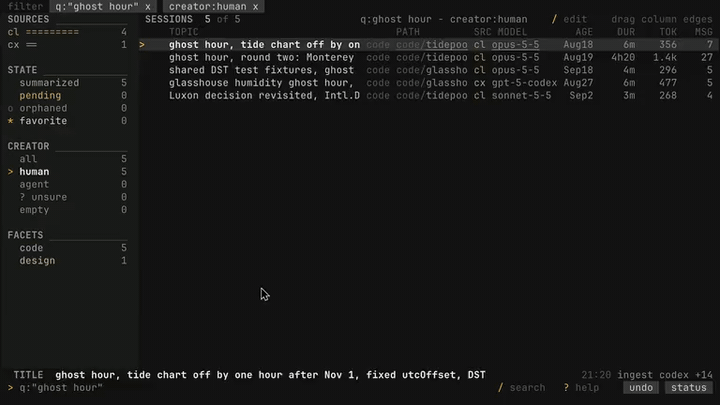

# Session Atlas

## Hello, human

When I started trying different coding agents (Claude Code, Codex, omp, Hermes) and Chinese models like Z.ai's GLM, DeepSeek and Kimi, the built-in histories couldn't keep up. It quickly became a mess between harnesses, models and their different locations, so I made one archive for all my sessions and added the search features I wanted. Agents use it most, but the UI is good enough for a human. 

---

*The rest of this README was written by an AI model (Claude Opus 5.5) from the code in this repository.*

### Why this is public

Session Atlas is personal software. I built it with AI coding agents for my own use: to keep every coding-agent session I have run, across several harnesses, in one searchable archive, and to hand a past thread to a fresh agent as a warm start. Take what's useful. It's unsupported, and I'm not promising fixes.

<p align="center">
  
</p>

## What it is

Session Atlas is a local archive and terminal UI for coding-agent transcripts
from Claude Code, Codex, Prime Agent, Hermes, Kimi, and the retained Kilo and
ZCode archives. It indexes their JSONL and SQLite files into one database and
provides a dense terminal interface, full-text search across every session, and
export of a chosen thread as a warm-start payload for a new agent.

It never writes to a source transcript. The index is a rebuildable cache;
favorites, summaries, tags and job records survive every rebuild, and favorites
keep their materialized verbatim text.

## Status

Heavy work in progress. The indexer, TUI, search, favorites, summaries, tags,
export, and rebuild paths all work and are covered by tests, but the surface
moves without warning, the schema is at version 13, and nothing here is
packaged, versioned, or supported.

## Install

Requires [Bun](https://bun.sh/) and a terminal with Unicode and true-color
support.

```sh
bun install
bun link
atlas
```

For repository-local use, replace `atlas` with `bun run src/cli.ts`. Or have your agent do it.

## First run

The first command writes a config file to
`$XDG_CONFIG_HOME/session-atlas/config.toml` (normally
`~/.config/session-atlas/config.toml`) containing standard local roots for every supported current and retained
harness, no provider credentials, and a database path under
`$XDG_DATA_HOME/session-atlas/atlas.db`. Missing roots and missing providers are
designed states, not errors; `atlas doctor` shows them.

```sh
atlas index
atlas doctor
atlas
```

Claude, Codex, Prime, ZCode-agent, and Kimi JSONL units are read through a
fixed 1 MiB window rather than loaded whole, so a 700 MiB session file indexes
without the memory to match. The first successful parse also writes an
owner-only, source-fingerprinted ingest sidecar beside the configured Atlas
database. Later full reconciliations elect candidates from sidecar headers and
load a compact body only when publication or repair is required. Dialogue is
retained; full tool/control payloads are replaced with digest, size, token, and
classification evidence before either the sidecar or Atlas database is written.

Large walks print RSS every 500 identities. `--full` performs a complete source
census but still reuses valid sidecars, and missing derived data is repaired
from archived evidence without reparsing the source.

## Using the TUI

The list is one row per session: favorite mark, title, project path, harness,
model, size, and age. Arrow keys or `j`/`k` move, `Enter` opens, `Space` peeks,
`/` searches, and `?` shows the full keymap. Titles are clipped to fit their
column; when the mouse or keyboard focus rests on a clipped row, the context
line under the list shows the whole title.

| Key | List | Session |
| --- | --- | --- |
| `Enter` / `Space` | open / peek | expand the current message's tools |
| `/` | search the archive | search the archive |
| `g` | cycle human / all / agent lens | |
| `1` `2` `0` | Claude / Codex / reset filters | |
| `f` · `h` · `x` | favorite · mark human/agent · select | favorite · mark · mark a span |
| `e` · `y` | export / continue · copy title | export / continue · copy message |
| `m` · `s` · `w` | | dialogue/activity mode · summary pane · wrap |
| `[` `]` · `n` `p` | | previous/next episode · previous/next session |
| `c` · `#` · `:` | grounded chat · tag page · command palette | same |
| `Esc` / `q` | back · quit | back |

Opening a session shows dialogue by default, with paragraphs restored where a
model layer has recovered them, episode boundaries, and an about pane with the
summary, facets, and tags.

## TUI performance

The scrolling list renders as one fixed-size text frame with SGR color spans
rather than a component per row, with compact hit zones for the mouse.
Whole-corpus analytics run in a separate read-only SQLite worker after 500 ms
without input. The performance gate enforces an 8 ms p99 over 4,000 real scroll
frames. Ranked search hydrates only the visible page plus a small runway and
pages forward through a relevance cursor.

## Commands

```text
atlas                         interactive TUI
atlas index [--full]          cache-aware complete source reconciliation
atlas search "query"          full-text search
atlas read <id> --mode stubs  print a session
atlas lineage [path]          a project's sessions across moves, renames, worktrees
atlas lineage --messages --from D --to D   that era's human messages verbatim
atlas summarize --backfill    resumable tier-1 summary backfill
atlas fav <id> [topic]        materialize the live tail as a favorite
atlas fav <id> --from 4 --to 9
atlas export tag:NAME --preview
atlas export favorites --launcher <name>
atlas note <native-id>        targeted ingest and summary hook
atlas repair targeted-ingest --older-than <Nm|Nh> [--yes]
atlas repair titles [--yes]   cap stored titles to the display projection
atlas layers plan <kind> --since all --dry   price a model layer run
atlas corpus save NAME "query"   snapshot a search as passage refs
atlas searches --agents       what agents searched for, and what they missed
atlas doctor                  census, source health, provider status
atlas rebuild [--hard]        shadow rebuild preserving favorites and model data
```

Both `atlas repair` commands preview by default and change nothing until
`--yes`. `targeted-ingest` marks interrupted targeted-ingest runs as failed
(bookkeeping, not a retry); `titles` caps stored titles to the 240-character
one-line display form, while title search keeps the full text.

Exports accept `session:N`, `chain:N`, `selection:N,N`, `tag:NAME`, and
`favorites`. Before writing anything, Atlas reports the predicted token count
against the budget, then compresses summaries in fixed stages. It never
truncates a favorite or an explicitly selected span. Payloads land in the data
directory's `exports/` folder. A configured launcher prints the exact command to
paste into a shell; Atlas does not spawn shell functions itself.

Rebuild is the only modal operation. It builds and validates a sibling database,
then swaps it in atomically. Favorites, summaries, anchors, tags, syntheses,
merge history, and jobs are carried over by stable session identity. Interactive
use requires confirmation; automation additionally requires `--yes`. In this
version `--hard` preserves the same data and differs only in its confirmation
word.

## Default interface and experimental library

The original **Ink dashboard is the default** (`atlas`, `atlas tui`). The
OpenTUI replacement is experimental and available only through `atlas library ui`.
The migrated archive, capture/search backend, MCP tools and saved data remain
intact and accessible through `atlas library ...`.

Ink reads its original configured index. If migration has protected that index,
it opens read-only and identifies the pre-migration view; it does not silently
write through the migration fence or pretend to show the new library schema.

See [Atlas library setup and evidence](docs/ATLAS-LIBRARY.md).

For a separate, colored comparison of the compact dashboard, run `atlas-test`
in another terminal. Cyan marks redesigned controls and labels; ordinary
`atlas` stays unchanged. The comparison reads the same index without indexing,
generating summaries, or changing saved data. See [comparison controls](docs/atlas-test.md).

## Configuration

Source roots are ordered, live location first and archives after:

```toml
[sources.claude]
roots = ["~/.claude/projects", "/Volumes/Archive/claude-sessions/projects"]

[sources.codex]
roots = ["~/.codex", "/Volumes/Archive/codex-sessions"]

[sources.prime]
roots = ["~/.prime/agent"]

[sources.hermes]
roots = ["~/.hermes/state.db"]

[sources.kimi]
roots = ["~/.kimi/sessions"]

# Retiring sources stay read-only; point these at owner-private copies.
[sources.zcode]
roots = ["~/.zcode"]

[sources.kilo]
roots = ["~/.local/share/kilo/kilo.db"]
```

[`harness-coverage.json`](harness-coverage.json) is the machine-readable source
and capture matrix.

Providers are optional and power only summarization, tag synthesis, and chat. API keys live in
environment variables; the config file holds names, not secrets:

```toml
[[providers]]
name = "glm-air"
base = "https://api.z.ai/api/paas/v4"
kind = "openai"
model = "glm-4.5-air"
key_env = "ZAI_API_KEY"
# Optional for OpenAI-compatible reasoning models when the task does not need it:
# thinking = "disabled"

[[launchers]]
name = "my-launcher"
cmd = 'my-agent-cli "$(< {payload})"'
```

Point providers at a general paid API endpoint. Subscription "coding plan"
endpoints generally limit their quota to that vendor's supported coding tools,
so Atlas refuses known coding-plan endpoints before any network traffic; the
`SESSION_ATLAS_ALLOW_UNSUPPORTED_PROVIDER=1` escape hatch exists for the case
where a vendor has explicitly authorized a custom application like this one.
Check the provider's current usage policy and pricing before any bulk
backfill; summarizing a whole archive is not a cheap operation.

`--config /path/to/config.toml` targets an isolated configuration and database.
Use it for rebuild tests and experiments rather than pointing them at a real
archive.

## Layers

Layers are derived annotations kept in a sidecar database beside the archive
(`atlas.layers.db`), so the main index never depends on them. Two are
provider-free and cheap: `creator` (who started the session, from voice and
harness evidence) and `shape` (episode boundaries). Five are model-backed:

| Layer | What it adds |
| --- | --- |
| `creator` | a model pass over sessions the rules left `unknown` |
| `paragraphs` | restores paragraph breaks flattened out of long messages; guarded by content hash |
| `episodes` | a short label per episode |
| `tiny-tags` | Obsidian-style tags per episode, reusing the existing vocabulary |
| `tag-rubric` | periodic merge / nest / demote / split decisions over the tag vocabulary |

Model layers run through headless Claude Code (`claude -p`): Haiku 4.5 for bulk
work and Sonnet 5.5 for the rubric. `atlas layers plan <kind> --dry` prices a run
before anything is queued, and the runner pauses when the subscription usage
window reaches 95% and resumes after it resets. Labels survive re-ingest only
for spans whose text did not change.

## Corpus and the search log

`atlas corpus` saves a search as a snapshot of passage references rather than
copied text, so a saved corpus is kilobytes, reruns against the current index,
and reports what was added or dropped. `atlas searches` reads the search log:
which person or agent searched for what, and which hits were outside that
caller's visible scope.

## Creator provenance

Sessions carry a `human`, `agent`, `mixed`, or `unknown` provenance derived from
harness metadata, and the list shows an effective `H`/`A` lens on top of it.
That lens defaults to Agent for anything unreviewed, because raw metadata
provenance turned out to be a weak signal in practice: a large majority of the
sessions it marked human were nothing of the kind. Press `g` to cycle
all/human/agent; `--origin human|agent|unknown|empty` applies the same effective
lens from the CLI. `unknown` is the rail's `? unsure`: dialogue exists, but no
rule or model could decide who opened it. `empty` holds sessions with no human
or agent turn at all (opened and closed, or harness plumbing only), which have
nothing to judge. `--origin mixed` remains available for diagnosing raw
provenance.

For a stricter lens there is an opt-in classifier, kept in its own auditable
table so it never overwrites provenance:

```sh
atlas classify-humans --limit 40           # preview only
atlas classify-humans --limit 40 --run
```

It sends nothing at all unless a key is set, and then sends only a redacted
240-character title/topic excerpt for `human` and `unknown` candidates, never
transcripts or adapter-proven agent sessions. The model may only promote a
session to human; ambiguous and omitted candidates stay agent. Every decision
stores its reason, confidence, model, provenance snapshot, input hash, and
timestamp. `--all` is resumable and stops on the first failed batch. Try it
against an isolated `--config` first, and watch the quota.

## Scheduling

The supported macOS installation is an owner-only pair of LaunchAgents: the
30-minute provider-free indexer and a one-minute presence watchdog. Reconciliation
health metadata uses 30 minutes expected, 90 minutes degraded, and six hours
stale. The watchdog only
re-bootstraps the indexer if its service disappears; it never reads transcripts
or calls a provider. Install or repair both with:

```sh
./scripts/ensure-launchd.sh --install
./scripts/ensure-launchd.sh --check
```

The checked-in templates are [`examples/com.session-atlas.index.plist`](examples/com.session-atlas.index.plist)
and [`examples/com.session-atlas.index-watchdog.plist`](examples/com.session-atlas.index-watchdog.plist).
The installer renders absolute paths, validates the complete `ProgramArguments`
contract, and loads both jobs in the current `gui/$UID` domain. The jobs run
local wrappers under `~/Library/Application Support/`, because macOS can refuse
to execute a launchd script from an external volume, and a job is unloaded
before its wrapper is replaced.

`--render /absolute/dir` writes the exact plists and wrappers, with SHA-256
hashes, without touching `~/Library` or `launchctl`. Rerun the installer after
moving the repository or config. Logs are owner-only under `~/Library/Logs/`.

`atlas doctor` checks both reconciliation freshness and whether a real launchd
service named by the installed plist is loaded. Schedule provider-backed
summarization separately, with explicit cost and stop boundaries.

Periodic provider-free reconciliation is the correctness path for durable
harnesses, especially Prime Agent: roots, RLM children, and tmux sessions may
settle without a SessionEnd event. Hooks reduce latency but never replace the
scheduled `atlas index` walk.

Claude and Codex `SessionEnd` hooks can run
`bun /path/to/session-atlas/scripts/note-hook.ts claude|codex`, which updates the
target session with no provider traffic by default. Set
`SESSION_ATLAS_HOOK_SUMMARIZE=1` in the hook environment to add immediate tier-1
summarization instead of leaving it to the resumable backfill.

## Data and privacy

Atlas reads source transcripts and never modifies them. Its data lives beside
the configured database (by default `~/.local/share/session-atlas/`):
`atlas.db` (the index), an owner-only ingest sidecar cache, `atlas.layers.db`
(layers, manual marks, corpora, and the search log), and `exports/`. The local
index is not redacted.

Indexing, browsing, search, and export make no network calls. Configured
providers (summaries, tag synthesis, chat) receive text only after keys,
tokens, PEM blocks, and high-entropy strings are redacted. Model layers send
message text to `claude -p` without redaction. `atlas search`, `read`, and
`lineage` log each query and its caller; `ATLAS_SEARCH_LOG=0` turns that off.

## Design invariants

The rules the code is written to hold:

- Source transcripts are read-only. Always.
- `ls`, `search`, `read`, and `doctor` open an existing archive strictly
  read-only: no database row/schema change, config bootstrap, lease, or indexing.
- Favorites are durable user data and keep their verbatim material through
  source pruning and every kind of rebuild.
- Every transcript byte sent to a configured provider passes through a single
  redaction boundary. Model layers call `claude -p` directly and are not
  redacted.
- One broken source unit never stops other units or other harnesses.
- Stable identity is `(harness, native_id)`. Database row ids are cache-local
  and meaningless across rebuilds.
- List excursions restore operator context, and every terminal mode is released
  on exit, error, interrupt, suspend, and resume.
- A missing provider disables model-backed features without disabling the
  archive.

## Development

```sh
bun test
bun run typecheck
git diff --check
```

## Keywords

coding agent session archive, AI chat history search, Claude Code transcripts, Codex sessions, Kimi, Hermes, Kilo, ZCode, Prime Agent, JSONL, SQLite, FTS5 full-text search, terminal UI, TUI, Ink, React, OpenTUI, Bun, TypeScript, MCP server, warm-start context export, session lineage, transcript summarization, secret redaction, launchd LaunchAgent, conversation history browser

## License

MIT. See [LICENSE](LICENSE).
